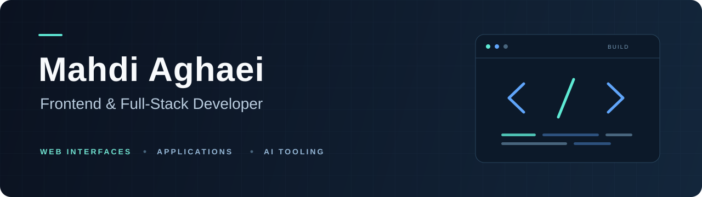

  

  <strong>React · Next.js · TypeScript · Node.js</strong> 
  Building thoughtful interfaces and the services behind them.

## About me

I'm Mahdi, a frontend and full-stack developer working with React, Next.js, and Node.js. I build web applications from the interface through to API integration and backend services, with a focus on clear interactions and maintainable code.

My work includes administration dashboards, subscriber provisioning interfaces, storefront UIs, and authentication and authorization workflows. I'm also exploring how AI agents can use tools with explicit access controls and useful monitoring.

## Technology stack

| Area | Technologies |
| --- | --- |
| Frontend | React, Next.js, TypeScript, JavaScript, Vite |
| UI & styling | Tailwind CSS, Ant Design, Bootstrap, Reactstrap |
| Backend & APIs | Node.js, Express, REST APIs |
| Data & tooling | MongoDB, PostgreSQL, Git, Docker |

## Featured project

### [MCP Security Gateway](https://github.com/MhdiAghaei/MCP_SECURITY_GATEWAY)

An academic prototype for controlling and monitoring AI agents' access to Model Context Protocol tools, with a React dashboard for exploring security activity.

- **Access control:** API-key authentication, role-based authorization, and default-deny policies for unconfigured tools.
- **Monitoring:** Tool risk classification, per-client rate limiting, and structured audit logs.
- **Agent integration:** Local tool calling with Ollama and Qwen3, automated security scenarios, and a benchmark runner.

**Built with:** TypeScript, Node.js, Express, MCP SDK, React, Ant Design, and Recharts.

[Explore the code and architecture →](https://github.com/MhdiAghaei/MCP_SECURITY_GATEWAY#readme)

---

[Browse my public repositories →](https://github.com/MhdiAghaei?tab=repositories)
